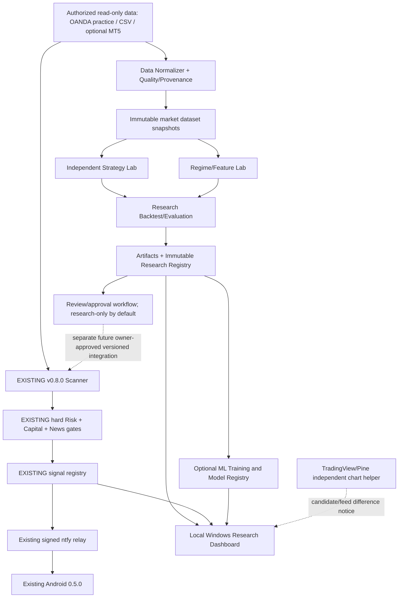

# AYESHA FX: Hybrid Advanced AI master plan (as reviewed)

This file keeps the owner's plan **AYESHA-HYBRID-AI-MASTER-001 v1.0** (2026-10-16) word for word below the line, so
the repository carries the design it is built from. Source file SHA-256:
`1b27b361e7b850905255ab7bac027e02ead2dcd3dc93ee84b60d92025b06fa94`.

Status: v0.9.0 (research foundation) is merged to `main` (`aad8dbd`), v1.0.0 (Strategy Lab) is merged to `main`
(`57b6a71`, PR #3). **v1.1.0 (regimes and historical news) is built on branch `research/v1.1.0`** and waits for the
owner's merge approval. v1.2.0 and v1.3.0 are not started. There is **no validated trading edge yet**; nothing in
the research plane is a trade signal.

## Review notes (CP-00 audit, 2026-10-16)

The plan describes the repository at `7e7da2e` (release 0.8.0) correctly except for these points. The code follows
the corrections; the plan text below is left unchanged.

1. The plan says `ayesha broker`; the real command is `ayesha confirm-broker` (`broker.py`, `broker-confirmed.json`).
2. `desktop/windows/make-signing-key.bat` exists but is not in the plan's file list (§1.1).
3. `ayesha.__version__` said 0.3.0 while the package was 0.8.0. Fixed in 0.9.0 (now equal to `pyproject.toml`).
4. VERIFICATION I01 called the commits after `c8dc37f` docs-only; `617f16c` and `7e7da2e` changed `cli.py`
   (both had green `ci`). Corrected in VERIFICATION.md.
5. The OANDA feed keeps BID OHLC and the ASK close only. ASK high/low are unknown and are never invented (as §4.2 asks).
6. `ayesha export` rounds the spread to whole points, so the same market data differs by up to half a point between a
   CSV import and a direct OANDA download. Parity is always measured on the same input, and this difference has its
   own code (`SPREAD_ROUNDED_TO_WHOLE_POINTS`).
7. `build-android` ran on any `contracts/**` change, so adding `contracts/research/` would have published a phantom
   APK with a new CI debug signer. 0.9.0 excludes `contracts/research/**` and `contracts/version.json` from that
   trigger (see DECISIONS.md).

## How 0.9.0 maps to the plan, and where it differs

| Plan | Built in 0.9.0 | Why it differs |
|---|---|---|
| §3 separate `desktop/dashboard/` package (`app.py`, `pages/…`) | `desktop/ayesha/research/dashboard/server.py` | One package and one install; the isolation check allows HTTP code in this one file only |
| §3 `storage/{db,migrations,artifacts,backup}.py`, `datasets/manifest.py` | migrations, backup, restore and audit in `storage/db.py`; artifacts in `datasets/store.py`; the manifest is written by `datasets/ingest.py` | Small enough to keep together; behaviour is what the plan lists |
| §3 `features/`, `regimes/`, `strategies/`, `models/`, `evaluation/{metrics,walk_forward,…}` | not built | v1.0.0 to v1.2.0. 0.9.0 uses the legacy walk-forward and metrics through the baseline adapter |
| §5.4 `feature_sets`, `model_registry`, `model_approvals` | not created | No features or ML in 0.9.0; they come with their own migration later |
| §5.4 (extra) | `research_jobs` (worker statuses), `artifacts`, `datasets.manifest_json` | Crash reconciliation and manifest checks need them |
| §9.1 pages Overview / Data Health / Strategy Lab / Replay / Results / Capital & Risk / News Context / Diagnostics / Settings | Overview, Data, Runs, Live scanner (read-only, money hidden), Diagnostics, Settings | Strategy Lab, replay chart and news context need v1.0.0/v1.1.0 data. Capital amounts are deliberately not shown |
| §9.1 buttons Run Research, Backup Research, Open Doctor | CLI commands and `start-research.bat --check` / `backup-research.bat`; the dashboard only links reports and exports | A GET-only page has nothing to forge (§10.3 CSRF); jobs run in the worker from the command line |
| §9.1 Bengali-first labels | Bengali + English navigation and banner, English technical tables, Bengali guide `docs/12-research-guide.md`; light/dark follows Windows | Technical codes stay English so they match logs and reports |
| §10.1 `ayesha research run --strategy X`, `report --run R --format md` | `ayesha research run baseline-sweep-mss-fvg --dataset D --symbol S`, `ayesha research report R --md FILE` | Chosen in CP-00 (subcommand, not a second executable). `compare`, `regime`, `ml train` come with v1.0.0 to v1.2.0 |
| §10.2 config | same keys, plus `memory_limit_mb`, `job_timeout_seconds`, `backup_keep`, `quality` | The safety locks are `const` in `contracts/research/research-config.schema.json`; an edited file can only turn research off |
| §12 tests T01 to T12 | T01, T02, T05 to T08, T10 automated; T12 partly (versions, base dependencies, forbidden imports, informational `pip-audit`, no lock file yet); T03/T04 stay covered by the legacy suite; T09 (ML) and T11 (Android) not applicable | See [RESEARCH_ACCEPTANCE.md](RESEARCH_ACCEPTANCE.md) |

## How 1.0.0 maps to the plan (§6, CP-04, AI-008, AI-009), and where it differs

| Plan | Built in 1.0.0 | Why it differs |
|---|---|---|
| §6.1 Baseline A SWEEP_MSS_FVG, unchanged | `strategies/baseline.py` wraps the live `MtfEngine` (M15, no M5 confirmation in the lab); through the common runner it equals the legacy replay trade for trade on every lab run (`benchmark_parity`) | The M5-confirmation mode stays on the 0.9.0 legacy path (`research run baseline-sweep-mss-fvg --mode m5confirm`) |
| §6.1 Control B, simple session/volatility rule | `control-london-orb`: London opening-range breakout, stop at the other side of the range, net 2R target, one per day, pre-registered bounds | Chosen because it uses no smart-money concept at all, so it shows whether the baseline's complexity adds anything |
| §6.1 Experimental C, H1/H4 trend continuation | `experimental-h1h4-trend`: H4 EMA trend, H1 pullback to its EMA, entry on the next H1 close beyond the previous bar | Exactly one experimental strategy, as the plan asks. Experimental D (order blocks etc.) is not built |
| §6.2 manifest, collisions, no writes to the spec | `research.strategy/1` manifest with `parameter_bounds` and `dependencies`; the loader refuses duplicate ids, more than one experimental, unknown or out-of-bound parameters, and parameters for the frozen baseline; each strategy gets a deep copy of the spec | Plugins are built-in classes only (no loading of outside code; the plan's §4.3 notes plugins are not a sandbox) |
| §6.3 realism | the legacy fill functions (bar spread on every fill, slippage buffer, stop first on a bar touching both, no profit on the fill bar, gap exits at the open, flat before rollover), the live sizing-independent gates, flags for stop-and-target bars and fill bars that reached the target | Historical contract values are ASSUMED Exness Standard values; news is NOT modelled (no permitted point-in-time calendar), so the strict live news gate is off in research and every result says so |
| §6.3 portfolio | `simulation/portfolio.py`: one hypothetical account across symbols with the live `risk.engine.evaluate` (1 % cap, minimum lot, two losses and daily loss, open risk, one position per currency), dynamic equity, scenarios $20 to $5,000 | Owner-marked broker fills do not exist yet; nothing inferred is stored as a real trade |
| §6.4 metrics | after-cost R with intervals, NO_TRADE and not-filled shares, folds, in/out-of-sample, sealed holdout, symbol/session/direction breakdowns, cost and parameter sensitivity, without-best-5 %, tails, losing streaks, exposure | Regime breakdown is `NOT_MODELLED` until v1.1.0; Sharpe only with 30+ closed trades |
| §10.1 `compare` | `ayesha research strategies`, `lab`, `run <strategy>`, `compare`, `comparisons`, `report cmp_…` | Comparisons are stored as `exports` artifacts and audit events, without a new registry table, so a rollback to 0.9.0 still reads the folder |
| §9.1 Strategy Lab page | dashboard `/lab` (strategies, comparisons), comparison and lab run pages with sanitised exports | Read-only as before |

## How 1.1.0 maps to the plan (§7, CP-05, AI-010, AI-011), and where it differs

| Plan | Built in 1.1.0 | Why it differs |
|---|---|---|
| §7.1 regime labels TREND_UP / TREND_DOWN / RANGE / HIGH_VOL / TRANSITION / UNKNOWN from as-of closed bars | `regimes/detector.py`, `regime-h4-er-slope-vol` 1.0.0: on each closed H4 bar (legacy aggregator), Kaufman efficiency ratio over 20 bars, EMA(20) slope in ATR units, ATR(14) percentile among the previous 120 values (past only); UNKNOWN during warm-up and after a gap longer than 4 days; each label carries its feature values, detection time and the detector's code hash | Thresholds were pre-registered before any real data was seen and are not tuned; a change needs a new detector version. Labels are computed once, forward in time, never rewritten. Context only: never a gate and never a reason to trade |
| §7.2 strategy × regime matrix, regime known at entry time, sparse cells `INSUFFICIENT_SAMPLE` | every lab order stores the label known when it was decided (`LabTrade.regime`, candidates `regime`); results have a matrix with every label, cells under 30 closed trades are `INSUFFICIENT_SAMPLE`; comparisons show the matrices side by side; `ayesha research regime --dataset D --symbol S` | No ranking by regime; on CI data every cell is synthetic and small |
| §7.3 `news_asof`: event timing, forecast/actual publication time, provider audit; missing history `BLOCKED_BY_DATA` | `datasets/news_snapshot.py` (`research.news-snapshot/1`): a calendar the owner is licensed to use is frozen like a dataset (raw bytes kept, content hash, provider and licence, integrity report PASS / DEGRADED / REJECTED), parsed with the legacy CSV reader and read only through the legacy point-in-time view `AsOfCalendar` (rows after `observed_utc`, actuals after `actual_published_utc`); `ayesha research news-ingest`, `news` | No licence or source ⇒ not imported; unknown snapshot ⇒ `BLOCKED_BY_DATA`; REJECTED snapshots cannot be used; DEGRADED ones (no `observed_utc`, actuals without a publication time) may be used but say so on every result. No historical calendar is bundled |
| §7.3 reuse `news.guard`, reaction analysis informational only | `simulation/runner.py` gates news with the legacy replay's own code paths: `legacy` (fixed window) or `upgraded` (the live `NewsGuard` on the point-in-time calendar, closed M5 bars, pending orders withdrawn when news turns against them); lab and comparison runs take `--news ns_… [--news-mode]` and show each strategy with news off, legacy and upgraded | Reused instead of rewritten, so the baseline still equals the legacy replay trade for trade with news on, in both modes. News direction (actual vs forecast) is never backtested; every news result says `NEWS DIRECTION NOT BACKTESTED` |
| §11 v1.1.0 broker-feed mismatch audit | `datasets/feed_audit.py` (`research.feed-audit/1`): two datasets of the same pair compared bar by bar (overlap, missing bars each side, OHLC and spread differences in pips) with fixed thresholds: MATCHED, DIFFERENT or INSUFFICIENT_OVERLAP; `ayesha research feed-audit`, `feed-audits` | Thresholds are fixed, not tuned: at least 500 common bars, close difference p95 ≤ 1.0 pip and max ≤ 5.0 pips, at most 2 % missing. Neither feed is the broker's truth; Exness parity stays UNVERIFIED unless one side is an Exness export of the same pair and the audit says MATCHED |
| §5.4 storage | snapshots (`.news.json` manifest + raw `.news.csv`) and feed audits (`.feed-audit.json`) are `exports` / `raw` artifacts with audit events `NEWS_SNAPSHOT_FROZEN` / `FEED_AUDIT_CREATED` | No registry migration, so 1.0.0 still opens a research folder written by 1.1.0 |
| §9.1 News Context page | Data page lists news snapshots and feed audits; comparison and lab run pages show the regime matrix and the news comparison; candidates show regime and news phase | No separate News Context page or replay chart yet; read-only as before |
| §4 contracts | `research_contracts` 3: `research.news-snapshot/1`, `research.feed-audit/1`; additive `regime` / `news_phase` on candidates and `news_snapshot_id` / `news_mode` / `regime_detector` on comparisons | Nothing removed; spec 0.4.0, signal schema 1.1 and wire 4 unchanged |

Related: [RESEARCH_DATA_POLICY.md](RESEARCH_DATA_POLICY.md) · [RESEARCH_ACCEPTANCE.md](RESEARCH_ACCEPTANCE.md) ·
[MODEL_GOVERNANCE.md](MODEL_GOVERNANCE.md) · [RELEASE_ROLLBACK.md](RELEASE_ROLLBACK.md) ·
[12-research-guide.md](12-research-guide.md) (বাংলা)

---

# AYESHA FX — HYBRID ADVANCED AI TRADING RESEARCH SYSTEM
## Architecture & Implementation Master Plan, v1.0 (বাংলা)

**Document ID:** AYESHA-HYBRID-AI-MASTER-001  
**Prepared:** 2026-10-16  
**Project:** https://github.com/arnobai70-del/Aysha-Point  
**Verified repository snapshot:** `main` — `7e7da2e715544dbbc023570275776258abd8bdd4` (observed 2026-10-16; re-check HEAD before implementation)  
**Source release:** AYESHA FX repository `0.8.0` (Desktop `0.8.0`; Android `0.5.0`; strategy `0.4.0`; signal schema `1.1`; phone wire format `4`)  
**Document status:** DESIGN APPROVED IN PRINCIPLE by owner selecting “Hybrid Advanced AI”; **no source code modified**, no Git commit/push, no real broker/account validation performed for this document.  
**Target milestones:** v0.9.0 → v1.0.0 → v1.1.0 → v1.2.0 → v1.3.0; milestone numbering is *proposed*, not already released.

---

## 0. TL;DR — mission, boundaries, deliverables

AYESHA FX-কে এমন একটি **Hybrid AI Research + Manual Trading Decision Support** প্ল্যাটফর্মে পরিণত করা হবে, যেখানে স্বাধীন Research Engine ঐতিহাসিক ও চলমান data পরীক্ষা করবে; তুলনাযোগ্য Strategy ও Regime result সংরক্ষণ করবে; গবেষণা, ব্যর্থতা, data limitations, risk এবং uncertainty দেখাবে; আর বিদ্যমান live scanner/advisory/Android alert ব্যবস্থা **আগের মতোই** চলবে। **AI কোনো trade place/modify/close করবে না**। ফলপ্রসূ বা নিরাপদ entry দাবি করতে হলে historical simulation-এর পাশাপাশি point-in-time validation, costs, broker feasibility এবং অন্তত 30 trading days demo/paper forward observation লাগবে।

### Non-negotiable requirements
1. Existing v0.8.0 modules, behavior, contracts, tests, capital rules, news gate, scanner states, Android pairing/signing and Pine output **backward-compatible** থাকবে। নতুন implementation feature flags দিয়ে OFF by default থাকবে।
2. Old path: OANDA practice/read-only market data → canonical rule scanner → existing hard risk + news + capital guards → SQLite signal registry → signed ntfy push → Android। নতুন গবেষণা path এ flow পরিবর্তন করবে না।
3. Research engine বাজারকে ব্যাখ্যা/মাপবে; **কোনো LLM বা ML prediction `READY`-এর source হতে পারবে না**, কোনো model risk/news gate খুলতে পারবে না, `NO_TRADE` override করতে পারবে না।
4. Broker Exness manual-only; Exness credential কখনো চাইবে না। Equity/positions/contract প্রতি-পেয়ারে owner-confirmed; OANDA practice account balance = **not** Exness capital।
5. Windows PC primary host; no mandatory VPS; offline/backfill/read-only operation। PC OFF থাকলে নতুন PC analysis/alerts নেই; Android cached data দেখাবে। TradingView free/basic থাকলে indicator; Pine বাইরের local AI result সরাসরি পড়তে পারে না।
6. Reproducible data snapshot/version/hash এবং trace। Training/validation ডেটায় future leakage, look-ahead, optimistic spread/slippage, strategy selection bias আটকাতে হবে।
7. Bangladesh-based owner-এর ক্ষেত্রে real-money FX/CFD সংক্রান্ত স্থানীয় নিয়ন্ত্রক বিধি যাচাই ছাড়া real-money use সুপারিশ নয়। এই প্রকল্প design/research এবং demo/paper হিসেবে কাজ করবে।
8. “AI” নাম হলেও v0.8.0-এর প্রধান logic **rule-based**। প্রকৃত ML পরে optional dependencies দিয়ে আসবে। লাভের নিশ্চয়তা, fixed success rate বা bank-এর গোপন order-flow দেখার দাবি থাকবে না।

### Outcome
- Windows **Research Dashboard**: current scanner state, dataset quality, strategy comparison, backtest, explainable regimes, costs and uncertainty।
- **Strategy Lab**: SWEEP_MSS_FVG baseline + independently testable, versioned experimental plugins।
- **ML Research Lab**: regime/anomaly/quality models, point-in-time evaluation, immutable model registry; no automatic promotion।
- **Mobile Companion (later)**: research summary, paper journal, capital/risk history; existing signal protocol untouched until explicit compatible version transition।
- Auditable release evidence; one-click return to `legacy_only` mode.

---

## 1. Current repository baseline: what exists and what does not

### 1.1 Confirmed source files (at snapshot)
| Area | Current implementation | Stability strategy |
|---|---|---|
| Spec/versions | `contracts/strategy-spec.yaml`, `contracts/version.json`, `contracts/signal.schema.json` | Do not change existing fields or strategy hash in foundation phases. Put research contracts in new files. |
| Live scanner | `desktop/ayesha/scanner.py` (`Scanner`, `Feed` protocol, `ACTIVE`, READY lifecycle) | No invasive rewrite; research reads historical snapshots or registry through a read-only adapter. |
| Rule engine | `desktop/ayesha/rules/{primitives,strategy,mtf}.py` | Preserve `SWEEP_MSS_FVG` baseline as frozen benchmark. |
| Risk | `desktop/ayesha/risk/engine.py` | Existing hard gates remain authority; research cannot mutate config or call evaluate in a way that unlocks READY. |
| Capital | `desktop/ayesha/capital.py` and `ayesha broker` owner-confirmed per-symbol Exness specs | Never infer balance from feed, never silently change account type. |
| News | `desktop/ayesha/news/{guard,classify,analysis,calendar,ff_feed,ledger}.py` | Preserve `NEWS_UNVERIFIED` and fail-closed logic; historical point-in-time provenance must be added separately. |
| Data | `desktop/ayesha/feed/{oanda_feed,mt5_feed,csv_feed}.py` | Reuse read-only feed via adapters; no unauthorized scraping or order endpoints. |
| Backtests | `desktop/ayesha/backtest/{replay,report,asof,inputs}.py` | Establish baseline with real data; add external research experiments without rewriting this replay. |
| Local registry | `desktop/ayesha/storage/db.py` → signals, signal_events, deliveries, engine_health, journal (SQLite WAL) | Never change old table formats in-place; separate research.db. |
| Windows setup | `desktop/windows/{install,start-ayesha,backtest-local,run-scanner}.bat` | No breaking prompts, flags, or restart behavior. |
| CLI/doctor | `desktop/ayesha/{cli,doctor}.py`; package `desktop/pyproject.toml` | Additive CLI commands only; old commands and exit codes tested. |
| Android app | `android/app/src/main/java/com/ayesha/fx/...`; core signing, alerts, journal, news, capital | No v0.9 protocol or data migration needed; later additive screens and tests. |
| TradingView | `tradingview/AyeshaSmartMoney.pine`, generated from template by `scripts/generate_pine.py` | No modifying Pine just to display imaginary off-platform AI agreement. |
| CI/safety | `.github/workflows/{ci,backtest,build-android}.yml`, `scripts/check_no_order_api.py`, `check_no_secrets.py`, `check_workflows.py` | Keep existing checks mandatory; add independent research checks. |

### 1.2 Version observations
- Release number is not equal to every component's version: source `0.8.0`; Android `0.5.0`; strategy `0.4.0`; signal schema `1.1`; wire `4`. Do **not** increment the strategy hash/version for purely visual or research-only improvements.
- README/STATUS/VERIFICATION describe complete unit/CI coverage for many paths, but real OANDA-token historical run, Android 13 device check, TradingView Pine compile, broker-spec owner confirmation and 30-day forward data remain pending. CI passing ≠ live verified.
- Existing risk configuration: default risk per trade 0.5%, maximum 1%; max daily loss 2%, 2 losses/day, max open risk 1%, min net RR 2, spread cap 1.5 pips, strict news and capital freshness requirements. Preserve existing checks; research displays constraints, does not bypass them.
- Canonical enabled FX pairs: EURUSD, GBPUSD, USDJPY, AUDUSD, USDCAD, EURJPY. Current live setup: `SWEEP_MSS_FVG`, H4 context + H1 bias + M15 setup, optional M5 confirmation. M1 scalp blocked until validated.
- Android no chart currently; “Pine ↔ Python automatic parity” still missing. In the first AI release display `UNVERIFIED` instead of claiming `MATCHED`.
- Research baseline should capture repo SHA and test results **as re-run evidence**, not assume developer docs equal current CI status.

### 1.3 Existing source of truth
1. Trading candidate: existing `Scanner` and canonical `strategy-spec.yaml` + hash.
2. Authorized order feasibility: existing `risk.engine` + live feed, verified broker contract, capital, market/news status.
3. Sent alerts: existing signal registry and signed push; status and expiry semantics unchanged.
4. Research insights: new research DB & frozen datasets; **informational, not entry authority**.

---

## 2. Target architecture — 3 independent planes



### 2.1 Data plane
- Fetch approved market datasets using currently supported **read-only** adapter. Preserve provider identifier, provider timestamps, bid/ask/spread basis, timezone, raw source hashes and licensing restrictions.
- Normalize to UTC **closed** bars; keep original bars or compressed immutable copy; record gap/duplicate/out-of-order/DST/negative-spread/future-time errors. Never fill a missing candle with synthetic prices and pretend it is real.
- Store a **content-hashed frozen snapshot** to make comparison fair. Feature and backtest runs pin the exact snapshot hash; if revised provider data arrives, write a **new** snapshot.
- Respect provider API limits; caching, chunked download, retry with exponential backoff; `401/403` fail with non-secret error.

### 2.2 Research plane (new)
- Uses frozen datasets; deterministic baseline and isolated experimental strategies produce **research candidates**.
- Offline as-of replay includes latency assumptions, bid/ask, conservative spread/slippage, rollover/news conditions, account/currency feasibility and dynamic equity. Report missing historical broker quotes instead of pretending available.
- Market regime classifier: initially deterministic rules (`TREND`, `RANGE`, `HIGH_VOL`, `TRANSITION`, `UNKNOWN`); any ML labels are experimental, never trade permission.
- ML training later: well-defined target (e.g. after-cost outcome distribution), train/validation/test separated by time, model metadata, calibrated probabilities only if empirically validated, uncertainty and drift monitoring.
- Research result registry stores paper-only decisions, metrics, provenance and explicit gate/owner approval state.

### 2.3 Advisory/experience plane (existing + additive)
- The **old scanner is canonical** for phone alerts. Read-only dashboard consumes canonical signals, health, news/capital warning codes and independent Research results with clear labels.
- Android research insights may be read via a new **versioned, authenticated channel** later; no equity/raw credentials sent through public relay, no altering wire v4 silently.
- UI displays three never-conflated labels: **LIVE ADVISORY** (old engine), **RESEARCH HYPOTHESIS** (unvalidated), **PAPER OBSERVATION** (logged, not a broker fill). No research card is shown as `READY`.

### 2.4 Isolation contract
- Default config `research.enabled=false`, `research.promotion.enabled=false`, `research.ml.enabled=false`.
- Import graph: `ayesha.research` **may import stable market models/adapters**; `ayesha.scanner`, `risk.engine`, `news.guard`, `capital` **must not import research modules** during foundation.
- Separate research process/worker (subprocess recommended) so ML/OOM/import failures cannot crash scanner or consume its event loop. Bound CPU/memory/concurrency; never lock live signal DB with long-running queries.
- Read-only access to legacy DB (`mode=ro` SQLite snapshot/backup connection) for UI; do not write directly to legacy registry.
- Optional future promotion requires explicit `strategy-id`, version, hash, signed owner approval and **new compatible policy integration** with old hard gates. Not part of v0.9.0/v1.0.0.

---

## 3. Implementation layout (additive only)

Proposed **new** paths; existing files at repo HEAD retain their behavior.

```text
Aysha-Point/
├── contracts/
│   ├── strategy-spec.yaml                  # EXISTING — no foundation edits
│   ├── signal.schema.json                  # EXISTING — no v0.9 edits
│   ├── version.json                        # EXISTING — bump repo/desktop only as needed
│   └── research/                           # NEW
│       ├── research-config.schema.json
│       ├── market-bar.schema.json
│       ├── dataset-manifest.schema.json
│       ├── strategy-plugin.schema.json
│       ├── research-result.schema.json
│       └── model-card.schema.json
├── desktop/ayesha/
│   ├── scanner.py                           # EXISTING; DO NOT REWRITE
│   ├── risk/ news/ capital.py               # EXISTING; protect with regression tests
│   ├── backtest/                             # EXISTING baseline runner remains
│   ├── storage/db.py                        # EXISTING legacy DB untouched
│   ├── research/                            # NEW independent namespace
│   │   ├── __init__.py
│   │   ├── config.py                        # research flags, strict validation
│   │   ├── contracts.py                     # typed protocols/dataclasses
│   │   ├── provenance.py                    # hashes, source, license, UTC
│   │   ├── datasets/{ingest,normalize,quality,manifest,store}.py
│   │   ├── features/{build,asof,registry}.py
│   │   ├── regimes/{rule_based,registry}.py
│   │   ├── strategies/{protocol,baseline,experimental,loader}.py
│   │   ├── simulation/{runner,costs,portfolio,news_asof}.py
│   │   ├── evaluation/{metrics,walk_forward,robustness,comparison}.py
│   │   ├── models/{train,predict,registry,monitor,explain}.py
│   │   ├── storage/{db,migrations,artifacts,backup}.py
│   │   ├── observability/{status,logs,metrics}.py
│   │   ├── cli.py
│   │   └── worker.py
│   └── dashboard/                            # NEW local application
│       ├── app.py
│       ├── read_models.py
│       ├── adapters/{legacy_registry,research_registry}.py
│       ├── pages/{home,data,strategies,replay,evaluation,models,settings}.py
│       └── assets/
├── desktop/tests/research/                  # NEW separate test suite
│   ├── test_data_quality.py
│   ├── test_point_in_time.py
│   ├── test_strategy_contract.py
│   ├── test_replay_parity.py
│   ├── test_walk_forward.py
│   ├── test_costs_and_risk.py
│   ├── test_ml_no_leakage.py
│   ├── test_crash_isolation.py
│   └── test_legacy_compatibility.py
├── desktop/windows/
│   ├── install.bat                          # EXISTING unchanged
│   ├── start-ayesha.bat                     # EXISTING unchanged
│   ├── start-research.bat                   # NEW optional, never mandatory
│   └── backup-research.bat                  # NEW
├── android/                                 # EXISTING untouched until v1.3 phase
├── tradingview/                             # EXISTING untouched unless separately specified
├── docs/
│   ├── HYBRID_AI_MASTER_PLAN.md             # NEW (this design after review)
│   ├── RESEARCH_DATA_POLICY.md              # NEW
│   ├── RESEARCH_ACCEPTANCE.md               # NEW
│   ├── MODEL_GOVERNANCE.md                  # NEW
│   └── RELEASE_ROLLBACK.md                  # NEW
└── .github/workflows/
    └── research-ci.yml                     # NEW optional job; old CI still required
```

**Dependencies:** keep default `pip install -e .` lightweight. Propose extras `[research]` for numpy/pandas/pyarrow (evaluate necessity), `[ml]` for scikit-learn optional, `[ui]` for PySide6 optional; pin tested versions and lock/constraints where reproducible. Do not add heavyweight ML libraries to base install or Android. No LLM API required. Do not use scraping of TradingView or market data without permission.

---

## 4. Contracts and canonical semantics

### 4.1 Compatibility invariants
- `contracts/signal.schema.json` still accepts `1.1` and `1.0` as already written; **no repurposing `score_points` as a probability** (`score_is_probability` remains false).
- Do not change existing `READY`, `WATCH`, `WATCH_M5`, `INVALIDATED`, `NO_TRADE` states/expiry semantics or signed wire-format `4`.
- Do not mutate `contracts/strategy-spec.yaml` for research-only settings. Preserve `strategy_hash` and Pine generated file checks unless live rulebook is intentionally revised in a future separately approved release.
- No research plugin can call order endpoints, broker credential endpoints, OS command execution from untrusted metadata or the existing registry's signal-update methods.

### 4.2 Proposed typed research data contracts

`MarketBar` (logical fields; validation via dataclass/Pydantic only in new optional code):
```json
{
  "schema_version":"research.market_bar/1",
  "provider":"OANDA_V20_PRACTICE",
  "symbol":"EURUSD",
  "timeframe":"M15",
  "bar_open_utc":"2026-01-05T10:00:00Z",
  "bar_close_utc":"2026-01-05T10:15:00Z",
  "bid_open":1.0,"bid_high":1.0,"bid_low":1.0,"bid_close":1.0,
  "ask_close":1.0,"volume":0,"is_closed":true,
  "observed_at_utc":"2026-01-05T10:15:05Z",
  "provider_record_id":null
}
```
Sample numerics above **are placeholders only**, never market evidence. For live/ML, if only BID OHLC and ask-close are available, do **not fabricate full ASK OHLC**; encode missing fields and cost uncertainty. Distinguish event time, observed time and actual publication time.

`DatasetManifest`: `dataset_id`, `source`, `symbols`, `timeframes`, `range_utc`, `downloaded_at_utc`, `raw_sha256`, `normalized_sha256`, `quality_report_sha256`, `license_notes`, `provenance`, `manifest_version`. Integrity decisions: `PASS`, `DEGRADED`, `REJECTED`; high-severity errors reject research metrics/promotion.

`ResearchCandidate`: `research_candidate_id`, `strategy_id`, `strategy_version`, `strategy_hash`, `dataset_id`, `asof_utc`, `pair`, `direction`, `levels`, `feature_snapshot_hash`, `explanation`, `rejection_codes`. Must carry `source_type=RESEARCH`, `executable=false`. No field named `safe_to_alert_for_entry` here to prevent accidental transport to phone.

`EvaluationRun`: `run_id`, `commit_sha`, `dataset_id`, `strategy_id/version/hash`, `parameters_hash`, `cost_model_id`, `account_scenario_id`, `news_snapshot_id`, `split_plan_id`, `started_at_utc`, `completed_at_utc`, `metrics`, `limitations`, `warnings`, `artifact_sha256`, `status`.

`ModelCard`: `model_id/version`, `feature_set`, `target/label_horizon`, `training_snapshot`, `train/validation/test_windows`, `hyperparameters_hash`, `seed`, `software_environment_hash`, `metrics_by_regime`, `calibration`, `stress`, `drift_reference`, `known_limits`, `promotion_status`.

### 4.3 Plugin interface and sandbox

```python
from typing import Protocol, Iterable

class ResearchStrategy(Protocol):
    strategy_id: str
    version: str
    def evaluate(self, context: "AsOfContext") -> Iterable["ResearchCandidate"]: ...
```

`AsOfContext` must expose **only** closed bars/events whose `observed_at_utc <= evaluation_utc`; no raw DataFrame handle to future rows. Strategies run sequentially by bar or through a controlled iterator and have pure/no-side-effect entry points. Validate strategy metadata; allowlisted local built-in modules only (arbitrary Python plugins are **not** a security sandbox). Independently version experimental parameters and candidate IDs so they never collide with legacy `signal_id`.

### 4.4 Version policy
- Repo release: increments as milestone outputs ship.
- Desktop component: increments with new research CLI/UI distribution.
- Legacy strategy (currently 0.4.0): stays unchanged until explicitly approved rule adjustment. Existing `strategy_hash` unchanged for research-only releases.
- Research contract uses separate namespaced semver (e.g. `research.result/1`).
- Existing Android/phone wire/Pine versions: no bump until changed. If future protocol extension necessary, implement dual decoder + old-payload compatibility fixture + on-device upgrade test before rollout.

---

## 5. Research data infrastructure (v0.9.0)

### 5.1 Datasets
1. First data source: `OandaFeed.candles()` for OANDA practice account, approved access and local token. Require explicit historical coverage and 5000-candle chunking (current adapter handles chunks).
2. Supplemental provider later only under explicit licensing and independent parser. Exness execution quotes are **not** assumed equal to OANDA. Measure/chart feed difference only when comparable real observations supplied; otherwise `UNVERIFIED`.
3. Historical dataset contains symbol + timeframe + closed-bar timestamps + bid OHLC + observed spread fields; source limitations disclosed.
4. Conform bar-close cadence (UTC bucket, weekdays/holidays, DST sessions). Explicit gap report; never silently forward-fill price for entry/SL/TP testing.
5. Historical macro calendar is optional/required by experiment. No historical source or stale calendar => `NEWS_UNVERIFIED` for strict simulations; *do not impute “no news”*.
6. Owner's Exness capital stays separate: research **scenarios** $20/$25/$30/$100/$500/$1000/$5000 are hypothetical; do not substitute as real equity. Standard versus Standard Cent require distinct risk/lot/contract handling.

### 5.2 Quality gates (suggested configurable, research-only)
- Reject duplicates with differing values, non-monotonic timestamps, negative/NaN/inf quotes, bid > ask where comparable, high < low, OHLC outside candle range, future observations and stale bars.
- Record gap count/coverage%, source/clock inconsistency and whether any OHLC or spread field is unavailable; do not pick fixed threshold without examining feed. **Only the acceptance policy** can permit a degraded snapshot for visualization, never silently for performance evidence.
- QA reports include original timestamps, timezone, data range, original/normalized hashes, missing bars by session and source count.

### 5.3 Local directories and storage
Default existing home: `%USERPROFILE%\AyeshaFX` (or `AYESHA_HOME`). New:
```text
%AYESHA_HOME%/
├── (existing capital.json, broker-confirmed.json, signal DB, pairing etc.)
└── research/
    ├── research.db             # NEW DB only; not old SQLite schema
    ├── manifests/
    ├── raw/                    # content-addressed, local
    ├── normalized/             # compressed snapshots
    ├── features/
    ├── models/                 # locally stored, versioned
    ├── reports/
    ├── logs/                   # sanitized
    └── backups/                # rotating verified backups
```

### 5.4 New research SQLite schema (separate migration chain)
Proposed entities and minimum keys:
- `datasets(dataset_id PK, provider, manifest_hash, data_hash, quality_state, created_utc)`
- `dataset_partitions(dataset_id FK, symbol, timeframe, start_utc, end_utc, artifact_sha, PRIMARY KEY(...))`
- `strategy_definitions(strategy_id, version, strategy_hash, parameters_hash, status, PRIMARY KEY(...))`
- `feature_sets(feature_set_id PK, dataset_id FK, version, lookback, artifact_hash)`
- `research_runs(run_id PK, dataset_id FK, strategy_id, version, commit_sha, config_hash, cost_hash, split_hash, status, created_utc)`
- `research_decisions(run_id FK, decision_id PK, observed_at_utc, pair, proposed_state, reasons_json)`
- `evaluation_metrics(run_id FK, period, regime, count, metrics_json, limitations_json)`
- `model_registry(model_id, model_version, run_id FK, artifact_hash, status, model_card_hash, PRIMARY KEY(...))`
- `model_approvals(id PK, model_id, model_version, owner_action, at_utc, note, prior_state)`
- `research_events(id PK, at_utc, actor, operation, target, prior_hash, resulting_hash)`

Use parameterized queries; `PRAGMA foreign_keys=ON`, WAL, separate schema migrations with idempotent verified backup, `PRAGMA integrity_check`, no raw secret/token fields. Write artifacts atomically (temp + fsync/rename where supported), reconcile artifacts and rows after crash. Data retention configurable; immutable evidence referenced by hash not overwritten.

---

## 6. Multi-Strategy Research Lab (v1.0.0)

### 6.1 Initial strategies
- **Baseline A — SWEEP_MSS_FVG:** wrap current signal-generation rules **without changing them**, run on frozen historical data, and compare with `ayesha backtest` under common assumptions. Treat it as benchmark, not a proven edge.
- **Control B — simple session/volatility baseline:** pre-registered deterministic rule, to reveal whether increased complexity adds value (research-only).
- **Experimental C — H1/H4 trend continuation:** new strategy behind `RESEARCH_ONLY`, no phone READY or Pine change.
- **Experimental D — order-block / breaker / IFVG / BPR hypothesis:** add one technique per independently measured experiment, not all at once.
- Additional SMT/multi-feed divergence only after documented synchronized provider coverage. No fabricated real bank flow.

### 6.2 Strategy registration
Mandatory manifest: ID, human explanation, timeframes, dependencies, supported symbols, parameter bounds, data lookback, statefulness, version/hash, flags `research_only=true`, execution level `NONE`, required news/cost source. Detect collisions at load time. One experiment cannot change another's parameters or write to legacy spec.

### 6.3 Backtest realism
- Bar-by-bar causality and no incomplete bar; signal time not before all confirming bars close. HTF indicators from *previously confirmed* bars; avoid pivots labeled at an earlier bar before right-hand confirmation.
- Entry/stop/target path ambiguous inside a candle? Conservative/worst plausible order or mark as ambiguous and provide sensitivity comparison; no invented tick-level path.
- Entry uses ask/bid appropriately; include spread, commission, slippage, missed fills, trading session, rollover; news `as-of` correct; account Standard/Cent feasible lot increments and margin budget.
- Historical contract values are owner-confirmed current values or *scenario assumptions*, clearly labeled. Do not imply a live Exness quote exists in OANDA historical records.
- Portfolio/equity simulation: enforce correlation exposure and overlapping setups, maximum daily loss/two losses, dynamic equity (research scenarios), no position overlap cheating.
- Trade/paper rows: planned hypothetical outcomes vs **owner-marked broker fills** distinctly tracked. No inferred fill recorded as a real trade.

### 6.4 Metrics and comparisons
Report by symbol, session, direction, regime, timeframe and account scenario: signal/trade sample size, blocked/ignored rate, after-cost expectancy in R, win/loss rate, median/mean RR, profit factor, max drawdown, exposure, Sharpe only when mathematically meaningful, distribution tails, cost sensitivity, worst-run and time-to-recovery. Always include baseline and `NO_TRADE` share, not only trades that survived selection.

---

## 7. Market Regime Intelligence (v1.1.0)

### 7.1 Regime labels (initial deterministic model)
- `TREND_UP`, `TREND_DOWN`: reproducible HTF trend-strength and slope metrics from as-of closed bars.
- `RANGE`: low directional strength and bounded/range measures.
- `HIGH_VOL`: pre-defined realized-volatility/ATR percentile relative to **past-only** rolling baseline.
- `TRANSITION`: regime boundary with low certainty.
- `UNKNOWN`: missing/insufficient/contradictory data.

Regime is **context**, not an independent permission to trade. Thresholds require registered research evaluation. Model output includes feature values, lookback window, source and explicit uncertainties. Regime changes must not retroactively rewrite historic labels: event time vs detection time separated.

### 7.2 Strategy × regime matrix
Evaluate each strategy on exactly the same chronological, quality-approved data and cost assumptions. Group results by regime *known at entry time*. Sparse cells = `INSUFFICIENT_SAMPLE`, no high rank. Include OOS fold intervals and uncertainty; a best strategy in hindsight **does not automatically become live active**.

### 7.3 News intelligence
Reuse `news.guard` for live protection only. Research `news_asof` honors event timing, forecast/actual publication timestamp, cancellations, revisions and provider audit. Market reaction analysis stays conditional/informational and never overrides strict live news guard. Missing historical releases are `BLOCKED_BY_DATA`.

---

## 8. ML Research Lab (v1.2.0, optional)

### 8.1 What ML may do
- Predict a **research label** such as future after-cost setup outcome distribution or regime classification, with stated horizon and censoring rules; never label it certain BUY/SELL.
- Cluster patterns or monitor data drift; rank evidence quality and uncertainty.
- Explain feature influence using safe methods, distinguish observed association vs causation.
- Optional offline language explainer may summarize **structured evidence** but cannot create levels/probabilities/gates not present in inputs. No network LLM service required.

### 8.2 Training/evaluation policy
1. Freeze problem/target and leakage-resistant features before viewing holdout results.
2. Temporal train/validation/test; **purged/embargoed splits** for overlapping outcome horizon; nested walk-forward where tuning is needed. No random shuffled K-fold for time-series outcomes.
3. Features computed as-of each decision; macro actuals available only after publication. No forward-filled future price, revised news metadata, labels from future pivots or whole-dataset normalization.
4. Pre-register limited experiments and multiple-testing control. Keep untouched final holdout; changes after evaluation require a new held-out period / prospective trial.
5. Compare to rule-only and simple baselines under **identical costs/feasibility**. Evaluate calibration, confidence intervals, uncertainty, false positives, time stability, sensitivity to spread and slippage.
6. Small signal counts ⇒ prefer no ML release. A plausible metric from 20 wins is not a reliable edge. Abstain `INSUFFICIENT_EVIDENCE`.
7. Save dataset hash, parameter hash, code SHA, Python/dependency versions, seed, model artifact hash and model card.
8. Training and ML prediction processes cannot access/expose broker credentials, Exness capital files or live signal write APIs.

### 8.3 ML lifecycle
`DRAFT` → `TRAINED` → `BACKTESTED` → `OOS_REVIEWED` → `PAPER_OBSERVATION` → `REVIEW_ELIGIBLE` → (future explicitly approved integration with hard gates). Any failed drift, data or safety check => `SUSPENDED`; automatic fallback to rule-only research. No “self-learning live model” that silently retrains/activates itself.

### 8.4 Drift monitoring
Compare changes in feed freshness, spread, missing bars, regime mix, feature distribution, label distribution (only after horizon completes), OOS outcome and calibration. Every alert says which source and reference period was used. Drift auto-**disables** experimental output; it does not increase lot/risk.

---

## 9. Dashboard & Android UX

### 9.1 Windows dashboard (v0.9.0 first release)
Navigation: **Overview / Data Health / Strategy Lab / Replay / Results / Capital & Risk (read-only) / News Context / Diagnostics / Settings**.
- Overview displays scanner state (read-only), data freshness, enabled pairs, news phase, current strategy version/hash, research worker health, last successful snapshot and missing credentials without disclosing them.
- Chart uses **local canonical OANDA snapshots**, not an invented TradingView integration. Overlay research candidate, actual source times, entry/SL/targets and reason timeline; badges `HYPOTHETICAL`, `BLOCKED`, `UNVERIFIED` when appropriate.
- Side-by-side comparison with one common source snapshot and selected costs; include small sample warnings.
- Clean layout, light/dark, Bengali-first labels with English technical glossary. No “one-click live trade”.
- Buttons: `Run Research`, `View Report`, `Export Sanitized Report`, `Backup Research`, `Open Doctor`; only real actions, with failure handling.
- UI must remain responsive if research worker crashes; `legacy_only` remains usable.

### 9.2 Android rollout (v1.3.0)
- Preserve App 0.5.0 notification inbox, journal, signed PC ready, news protection, owner-entered capital and backup/restore.
- Add opt-in **Research** tab: phone receives minimal versioned signed report summaries, not datasets/secrets/equity. All shown as `RESEARCH ONLY`; no confused Android `READY`.
- Connectivity issues show cached report with age and `OFFLINE`; NEVER stale research as current live setup.
- Stable owner signing certificate required; verify journal survives actual upgrade before shipment.
- If another synchronization channel is added (e.g. private LAN/Tailscale), it must be explicitly optional and authenticated, with no public listener by default; never replace the existing signed relay unexpectedly.

### 9.3 TradingView reality
Pine indicator independently calculates chart candidates and cannot pull local Python AI snapshots. Existing version generated from spec remains intact. Build a **local** replay/companion chart for exact scanner/research visual alignment; show `UNVERIFIED` feed parity unless measured across matching timestamps. No promise of exact Pine/PC 1:1 sync.

---

## 10. CLI, config, deployment & operational model

### 10.1 Proposed new commands — **not currently implemented**
```bash
ayesha research doctor
ayesha research ingest --provider oanda --pairs EURUSD --days 730
ayesha research inspect --dataset <DATASET_ID>
ayesha research run --strategy baseline-sweep-mss-fvg --dataset <DATASET_ID>
ayesha research compare --runs <RUN_ID_A>,<RUN_ID_B>
ayesha research regime --dataset <DATASET_ID>
ayesha research report --run <RUN_ID> --format md
ayesha research backup
ayesha research dashboard
ayesha research ml train --experiment <CONFIG_FILE>   # optional, disabled by default
```
These are **design examples**, not commands to run against current v0.8.0. Add to existing `ayesha.cli` only through tested additive subparsers or a separate executable entrypoint `ayesha-research`; choose and document one without breaking old argv/help/exit codes.

### 10.2 Research configuration
Example new local `research/config.yaml` validated against a new schema:
```yaml
research:
  enabled: false
  role: RESEARCH_ONLY
  promotion_enabled: false
  live_scanner_hooks_enabled: false
  ml_enabled: false
  workers: 1
  cpu_limit_percent: 40
  data_source: OANDA_V20_PRACTICE
  account_scenario: DEMO_ONLY
  allow_outbound_model_inference: false
  report_redact_secrets: true
  historical_news_policy: REQUIRE_POINT_IN_TIME
  dashboard_bind: 127.0.0.1
  legacy_only_fallback: true
```
Values are proposal; enforce safe defaults and resource limits with platform-appropriate mechanisms, not pretend YAML alone guarantees CPU isolation.

### 10.3 Operational behavior
- On Windows scanner start script, legacy scanner starts exactly as before. Research startup is separate/optional.
- Windows sleep/offline: mark `STALE/OFFLINE`, no new READY from stale data; previous app cache view only.
- Restrict local dashboard by loopback, and CSRF/auth if browser-based; avoid opening ports for public Internet. PySide6 native UI is fine, with optional local API only if needed.
- Backup local research DB + manifests + selected artifacts consistently using SQLite online backup API and integrity checks. Old user capital/journal backups remain independently handled; never delete legacy files in cleanup.
- Logs redact tokens, passwords, pairing codes, signing data; exported reports default no credentials/private portfolio fields. GitHub public build artifacts never include owner-private research datasets.

---

## 11. Milestone implementation: gated phases and DoD

### Gate G0 — Baseline freeze/audit (before editing any production logic)
**Deliver:** record main SHA, release versions, dependency set and CI artifacts; baseline on Ubuntu/Windows; Android unit/build, generated Pine parity check, existing secret/order scans; file-level map; short regression fixtures; current STATUS/VERIFICATION discrepancies list.

**Commands (example on authorized dev machine):**
```bash
git fetch origin
# Work from a pinned HEAD/branch, not a moving checkout
git rev-parse HEAD
cd desktop
python -m pip install -e ".[dev]"
pytest -q
cd ..
python scripts/check_no_order_api.py .
python scripts/check_no_secrets.py .
python scripts/check_workflows.py .github/workflows
python scripts/generate_pine.py --check
```
**Exit gate:** old tests and safety checks pass; any baseline failures documented as pre-existing rather than hidden; no secrets committed.

### v0.9.0 — Research Foundation and Windows visualization
**Build order:**
1. New `contracts/research/` schemas, separate configuration, policy and additive packaging extras.
2. Read-only feed adapter + canonical frozen dataset snapshots + quality/rejection reports. Owner-run OANDA authorized practice token. Store local only.
3. New isolated SQLite Research Registry, migrations, backup/restore and provenance.
4. Reproducible legacy benchmark replay adapter and comparison with old backtest outcomes on the same input/assumptions.
5. Start separate research worker with fail-safe isolation and `research doctor`.
6. Simple Windows dashboard read-only views: feed/legacy health, dataset catalog, replay/metrics, report export; do not invent automated access to Exness.
7. CI research tests (lightweight fixtures) + Windows smoke tests, docs and changelog.

**Acceptance criteria:** flags OFF causes bit-for-bit equivalent legacy behavior on controlled inputs (same IDs/statuses/push payload hashes); research crash does not impact scanner; no order APIs; malformed/gapped data fails closed; repeat run same hashes/metrics; research does not change strategy spec/hash/wire; old Windows install/start stays functioning.

### v1.0.0 — Multiple Strategy Lab
**Build:** `ResearchStrategy` contract, frozen SWEEP baseline, deterministic simple control, exactly **one** isolated experimental strategy, common run manifest, cost-aware portfolio simulator, after-cost metrics, side-by-side results. Separate strategy registry; experimental candidate never pushed.

**Acceptance:** replay causality/entry ambiguity tests; old baseline benchmark parity within explicitly explained differences; identical dataset/splits/costs across strategies; parameters/strategy code versions recorded; no `READY` from new plugin; small sample warnings.

### v1.1.0 — Regime & news comparison
**Build:** deterministic as-of regime detection; strategy × regime matrix; data/news and broker-feed mismatch audit; point-in-time news comparisons only when legally permitted historical events + actual publication timestamps exist; optional visualization of market phases.

**Acceptance:** no future-based regime labels; insufficient sample returns `INSUFFICIENT_SAMPLE`; unknown event provenance => `BLOCKED_BY_DATA`; no positive news prediction claims; real feed parity remains UNVERIFIED unless measured.

### v1.2.0 — ML Research Lab
**Build:** separate optional ML environment; versioned features + labels; time-series purged/embargoed walk-forward + untouched holdout; simple baselines; model cards; drift/anomaly monitor; gated signed owner approvals for research state only.

**Acceptance:** leakage test with future-data mutation does not alter past feature/predictions; no strong result without adequate sample; model registry reproducible on same pinned data/code; stress tests; ML unavailable still leaves scanner, dashboard baseline and normal alerts intact; ML never opens a live gate.

### v1.3.0 — Integrated Research UX + Android summary
**Build:** improved local chart/replay + research dashboard UX; optional signed phone research summaries and offline cache; Android journal backup/update tests; failure/status handling; bilingual labels and full docs.

**Acceptance:** Android unit/physical upgrade tests; no broken old wire-4 READY; signed summary cannot become READY; offline data marked stale; owner can disable research and revert without reinstalling core scanner.

### Beyond v1.3.0 — only after owner reviews evidence
Possibility: experiment-to-advisory bridge, additional rules, real feed parity, independent third-party historical calendars, alternative research providers. Requires a **separate change specification**: existing hard risk/news/capital guard and deterministic signal identity must still be authority. Never automate brokerage execution.

---

## 12. Validation gates — prevent false discoveries

### Required evaluations before any claim of a trading edge
- At least **2 years historical data where legally available** across relevant majors (existing roadmap); exact available sample/quality disclosed, not claimed until acquired.
- Chronological in-sample and untouched out-of-sample; 4+ walk-forward folds if enough data, with purge/embargo for overlapping trade outcomes.
- Expected net R after fees, worst-case slippage/spread, drawdown, loss tail, variance, confidence intervals, number of independent trades and strategy comparison baseline.
- Sensitivity: spread +25%/+50%, adverse slippage, delay one closed bar, perturb parameter boundaries, remove best trades, session subset; record whether advantage persists.
- Account minimum lot, stop constraints and margin verified for Exness **per pair** by owner. $20–30 Standard typically yields `NO_TRADE` at prudent risk; do not make trade feasible by secretly increasing risk.
- Shadow/paper forward monitoring for **≥30 trading days**, all signals (including NO_TRADE and invalidation), outage/duplicate rates, mark outcomes manually; no broker fills inferred from price history.
- Pre-specified minimum sample and uncertainty criteria based on effect size/variance; no cherry-picked win rate threshold. “OOS > 0” alone does **not** establish durable trading edge.
- Model drift or source change resets eligibility and requests re-validation. Newer better-looking parameters on holdout require new prospective evidence.

### Tests CI must add without replacing old CI
- T01 snapshot hashing/replay determinism + atomic writes
- T02 closed bar, as-of news, future data mutation and no-lookahead
- T03 bid/ask, spread/slippage, stop-first ambiguity and different fee assumptions
- T04 per-pair Exness spec, Standard/Cent, min-lot NO_TRADE, risk hard cap and correlated exposure
- T05 research-only plugin cannot write to legacy DB, leak token or produce live `READY`
- T06 test `research.enabled=false` exact baseline output parity
- T07 research worker crash/memory/resource overload does not affect scanner
- T08 dashboard only loopback; escaping/sanitization; privacy and export redaction
- T09 chronological walk-forward, embargo, untouched holdout and model provenance
- T10 rollback from every phase to v0.8.0 behavior without data loss
- T11 Android old payload compatibility, stable signing and journal retention (when Android modified)
- T12 dependency lock/version reproducibility, vulnerability scan, no forbidden imports/order API

Keep existing `ci`, `relay`, `news`, `build-android`, `check_no_order_api`, `check_no_secrets`, `check_workflows`, Pine generator checks. Add e.g. `research-ci.yml` **parallel**, never replace mandatory existing jobs. If research tests are expensive, fast PR smoke suite and separately scheduled owner-triggered long runs, with artifact access/privacy limits.

---

## 13. Fault scenarios and fallback runbook

| Fault | Required effect | Reconciliation |
|---|---|---|
| OANDA token missing/rejected | New ingest stops, `DATA_UNAVAILABLE`; old `ayesha doctor` behavior unchanged | Owner fixes token locally; never log token |
| News history absent | `BLOCKED_BY_DATA`; cannot compare historical news effects authoritatively | Owner supplies licensed point-in-time CSV; manifest provenance |
| Corrupt research DB | Research disabled, scanner remains available; backup restore | Integrity check → last verified backup; no auto-delete |
| Research model crashes/OOM | Research-only suspended and visible warning | Restart worker independently, limit resources |
| Research model drift | Disable ranking/prediction; show outdated model | Re-train only as a new version and re-evaluate |
| Legacy signal status differs unexpectedly | Release fails / rollback, never “fix” by re-labeling history | Golden fixtures, git bisect, failure evidence |
| PC offline/clock skew | No credible new live alert; research cache tagged stale | Recheck market/clock/data before continuing |
| Phone disconnected | Old inbox retained; summary tagged stale; delivery replay protection remains | Authenticated reconciliation, no duplication |
| New APK signer mismatches | Do not uninstall blindly; preserve journal backup | Build with persistent owner key; inspect certificate |
| Bad research config/input | Reject with actionable error code; legacy_only fallback | Config schema validation and defaults |

**Rollback method:** toggle research OFF, stop research worker, launch existing `start-ayesha.bat`. Existing data/registry must be intact. Restore vetted pinned legacy commit only after owner approval, backing up relevant files first. Do not force-push, wipe SQLite/journal, rotate pairing codes or replace Android app as a side effect of research rollback. Every milestone must document actual tested rollback steps.

---

## 14. Git workflow, team/Claude handoff and change policy

The owner previously permitted direct main pushes in the old workflow, but **this planning request does not authorize writing source files**. For a complex compatibility migration prefer one feature branch or isolated PR per milestone; explicit owner-approved push/merge. Never claim deploy/CI success without checking actual results.

### Atomic task order for Claude / coding agent
1. Inspect repo HEAD, README, STATUS, VERIFICATION, FEATURE_MATRIX, `contracts/version.json`, `strategy-spec.yaml`, `desktop/ayesha/scanner.py`, `risk/engine.py`, `news/guard.py`, `capital.py`, `storage/db.py`, `cli.py`, Android signature/fixtures and workflows. Output current-feature matrix **before edits**.
2. Pin SHA and run baseline full tests. Stop if baseline fails; report exact failing test and decide whether pre-existing.
3. Implement **only** current approved milestone; use feature flags OFF, new modules/directories, no duplicative legacy functions.
4. Add tests for old + new behavior, safety scans, docs, generated artifacts and new model contracts. Record before/after test counts and errors.
5. Run Windows CI and Ubuntu CI; Android/Pine tests if touched. Never fake test pass, results, dataset provenance, or screenshots.
6. Provide diff inventory: unchanged legacy modules, modified legacy files with reason, migration plan, backwards-compat evidence, risk review, rollback command, report paths, commit refs.
7. No use of secrets in commits/artifacts/issues; owner enters tokens on own PC. Publish only sanitized fictional/sample data.
8. Wait for owner sign-off at each milestone's acceptance gate. Do not automatically enable live research signal integration.

### Deliverables per milestone
`README` quick start; changelog; one line in `STATUS` and VERIFICATION per acceptance test; new config/schema with examples; code, tests, CI output logs; sanitized demo report; release manifest (`repo SHA`, component versions, schemas, hashes); Owner setup (Bangla); rollback instructions. App release contains SHA-256 and stable signer metadata when Android is updated.

### Prompts / implementation checkpoints
**CP-00 Baseline snapshot (first request):** “Read all core modules at pinned HEAD; create a non-mutating current-vs-target gap report and regression risk map. Run tests and show exact results. Do not edit files.”

**CP-01 v0.9.0 Data:** “Implement `contracts/research` + research-only data manifest/quality store; no changes to scanner/risk/news/capital or phone wire, flags OFF, immutable snapshots, tests for point-in-time.”

**CP-02 v0.9.0 Research DB:** “Add separate `research.db`, migrations/backups/artifact hashes, read-only legacy viewer, tests and crash recovery; no legacy database writes.”

**CP-03 v0.9.0 UI:** “Add local dashboard + research worker with one-click start/stop, diagnostics, data quality chart, historic results only; existing Windows scripts unchanged; CI and rollback.”

**CP-04 v1.0.0 Strategy Lab:** “Add typed strategy plugins, baseline parity adapter + one research-only experimental strategy, common cost-aware replay and comparison with provenance.”

**CP-05 v1.1.0 Regime:** “Add past-only regime features/strategy-regime matrix and as-of news comparison guarded by data provenance; reject missing datasets.”

**CP-06 v1.2.0 ML:** “Only after enough validated data: add optional ML extras, purged temporal CV, frozen final holdout, model card/registry, resource isolation, no live permission or READY.”

**CP-07 v1.3.0 Mobile:** “Add signed versioned research summaries to Android separately from signed READY path, preserve wire v4/legacy backup and stable APK signing, test offline and upgrade.”

---

## 15. Owner action checklist & gates

### Before v0.9.0 code is called operational
- [ ] Windows version/spec, Android version, available disk/RAM, and Internet pattern confirmed.
- [ ] OANDA practice/read-only API token configured locally (never share token in chat/GitHub).
- [ ] `ayesha doctor` result redacted and checked; allow source to fetch real *permitted* market history.
- [ ] Exness Standard/Standard Cent selection, account currency USD/USC, six per-pair contract sizes/min/step/commission/stop level/leverage/typical spreads confirmed **by owner**; equity typed on PC and phone independently. Trading laws checked before any live broker use.
- [ ] Historical market data exported to local folder; news history source available/legally usable if news comparison requested.
- [ ] Baseline physical PC + Android notification + Pine compile results recorded; device issues separated from AI work.
- [ ] Backups of user journal, capital, confirmed broker specs, signing key and pairing information handled **securely and locally**.

### Acceptance sign-off per release
- [ ] Baseline regression tests still pass.
- [ ] No new order/modify/close endpoint reachable anywhere.
- [ ] No changes in previously correct NO_TRADE and READY guards.
- [ ] Independent source snapshot, reproducible report and event-time provenance shown.
- [ ] No historical, OOS, paper or production result called “guaranteed”.
- [ ] Research killed/disabled → old app works; rollback tested.
- [ ] Documentation and truthful verification status updated.

---

## 16. Explicit exclusions in this plan

- Automatic order placement, take-profit editing, stop-loss modifying, copy trading, martingale, grid, doubling risk, bypassing broker limitations or anti-bot controls.
- Predicting exact next candle as guaranteed or model “self-learning” that changes live trade authority without governance.
- Pretending speculative price patterns reveal actual proprietary bank positions/order intent.
- Building a mandatory VPS, exposing the owner's scanner/dashboard publicly, moving private broker/account secrets to the phone relay.
- Claiming free TradingView Pine can ingest arbitrary PC/AI data or identical Exness–OANDA quotes.
- Training on unpublished macro data or historical backtests using numbers unavailable at the time.
- Promoting any strategy into live advisory without a separately authorized, risk-reviewed integration and sufficient validation evidence.

---

## 17. Initial ticket backlog (suggested labels and exit tests)

| Ticket | Title | Suggested release | Exit criterion |
|---|---|---|---|
| AI-001 | Freeze v0.8.0 baseline evidence | gate G0 | SHA, baseline tests & component matrix |
| AI-002 | New namespaced research contracts | v0.9.0 | Schema tests + zero old spec hash change |
| AI-003 | Frozen local market snapshots | v0.9.0 | reproducible hash + rejection report |
| AI-004 | Separate research DB / backup | v0.9.0 | fault and rollback tests |
| AI-005 | Baseline backtest parity adapter | v0.9.0 | golden parity + differences explained |
| AI-006 | Local research worker + health | v0.9.0 | scanner unaffected by worker crash |
| AI-007 | Read-only desktop research overview | v0.9.0 | data/health/replay visible offline |
| AI-008 | StrategyProtocol & controls | v1.0.0 | experimental signals never reach READY |
| AI-009 | Uniform cost-aware comparison | v1.0.0 | equal snapshots, split, fees and audit |
| AI-010 | As-of regime analysis | v1.1.0 | no future-regime leakage |
| AI-011 | Historical news integrity path | v1.1.0 | missing source ⇒ blocked by data |
| AI-012 | Optional ML registry/holdout | v1.2.0 | reproducible OOS + model card |
| AI-013 | Model drift/suspend/fallback | v1.2.0 | auto suspension and legacy-only safe |
| AI-014 | Android research companion | v1.3.0 | old alert behavior, signer, journal pass |
| AI-015 | Audit trail & sanitized export | across milestones | hash-linked audit no secrets |
| AI-016 | Windows packaging + rollback QA | across milestones | novice-readable install and recovery |

---

## 18. Claude-ready single instruction (copy/paste)

> You are the senior architect and lead engineer of the existing AYESHA FX repository: https://github.com/arnobai70-del/Aysha-Point. Read the attached `AYESHA_FX_Hybrid_Advanced_AI_Master_Plan_v1.0.md` in full. Current reviewed source snapshot is `7e7da2e715544dbbc023570275776258abd8bdd4`, repo release 0.8.0. First re-check current HEAD and diff vs pinned baseline, document changes and run all current safety/CI tests. **Do not immediately rewrite existing scanner, risk, news, capital, strategy spec, signal schema, phone wire v4, Pine, Windows setup or Android app.** Begin with CP-00 non-mutating audit and an exact v0.9.0 ticket/diff proposal. New research must be separately configured, off by default, research-only, side-effect free regarding legacy signal registry, and incapable of orders or READY. Never claim positive results from synthetic tests or invent source data; respect no-lookahead/time-series OOS/after-cost evaluation. Keep historical and private data local, credentials out of repos/logs. Only implement the next owner-approved checkpoint after the audit. Every milestone must include code, automated acceptance tests, current verified status, compatibility proof, rollback instructions and full documentation. Do not push/merge/deploy without the owner's explicit instruction. When information is missing, mark `BLOCKED_BY_DATA` or `PENDING_OWNER`; do not silently bypass safety gates.

---

## 19. Decision summary

**Approved product direction:** Hybrid Advanced AI Research + manual advisory.  
**Next engineering action:** CP-00 read-only audit and baseline freeze; then v0.9.0 research data + independent registry.  
**Must not start yet:** unverifiable ML auto-learning, live signals from experimental models, automatic trading, model promotion or heavy Android/Pine rewrites.  
**Success means:** reliable evidence, explainable performance comparisons, guarded research progression, intact legacy behavior — **not** guaranteed trading profits.

### Source files reviewed for this plan
- Repository snapshot tree and `contracts/version.json`, `contracts/strategy-spec.yaml`, `contracts/signal.schema.json`.
- `README.md`, `docs/STATUS.md`, `docs/ROADMAP.md`, `docs/MASTER_CHECKLIST.md`, `docs/FEATURE_MATRIX.md`, `docs/VERIFICATION.md`, `docs/SECURITY.md`, `docs/00-plan-review.md`.
- `desktop/ayesha/{scanner,cli,models,config,paths,doctor,signing}.py`, `desktop/ayesha/storage/db.py`, `desktop/ayesha/rules/strategy.py`, `desktop/ayesha/backtest/{replay,report,inputs}.py`, `desktop/ayesha/feed/oanda_feed.py`, `desktop/pyproject.toml`.
- `.github/workflows/{ci,build-android}.yml`, tree of Android and other project paths.

**Important:** Snapshot review covers architecture, contracts and representative source; it is not a claim that every line was dynamically exercised. The first actual implementation task is to run baseline tests on the exact checked-out revision.
